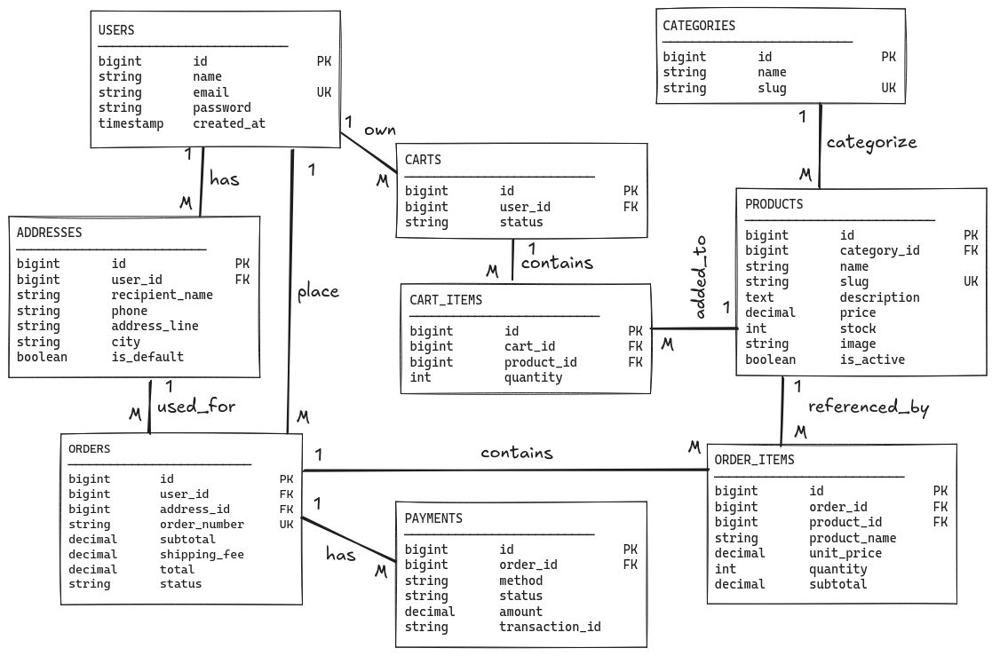
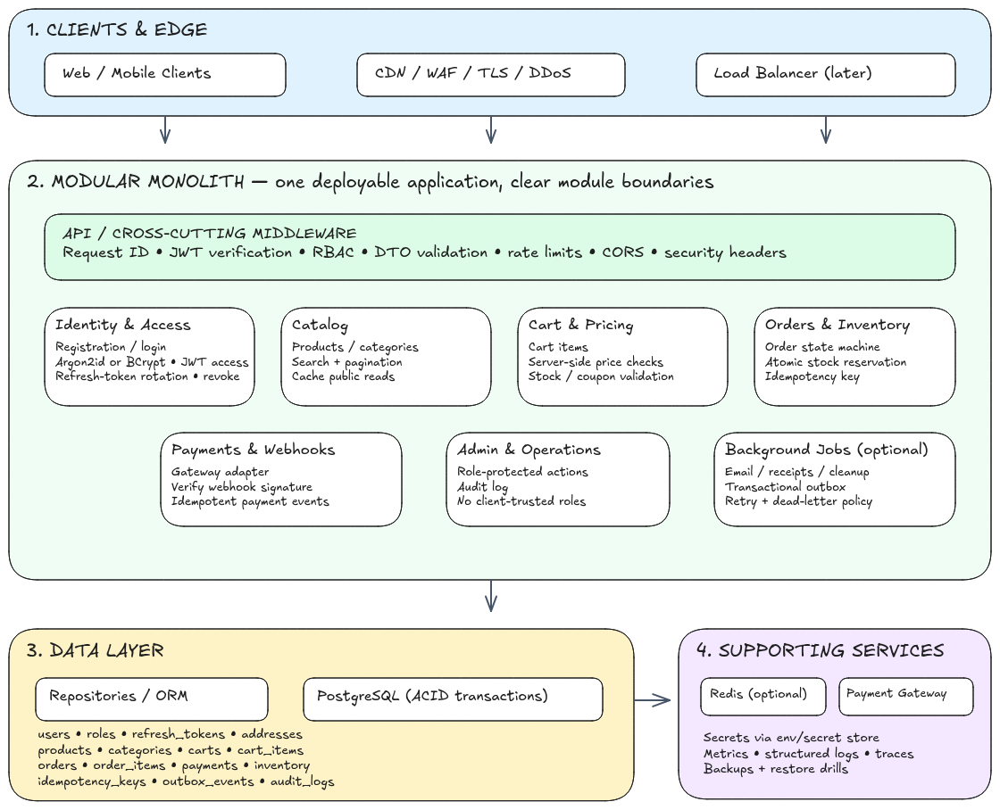
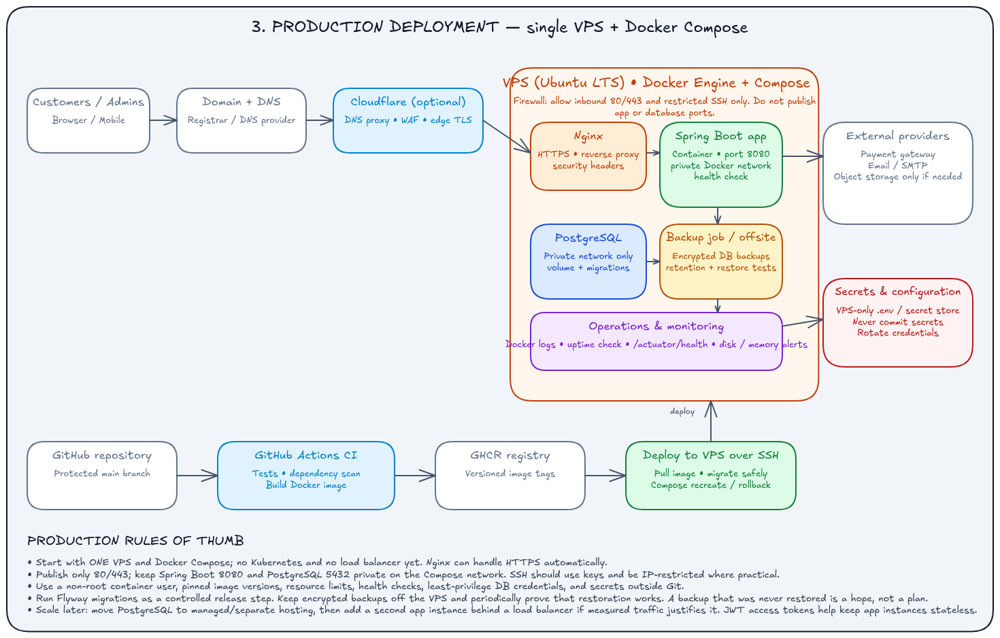

# Monolith E-commerce Backend

A production-minded **modular monolith** e-commerce backend built with **Java** and **Spring Boot**. The project focuses on solid software engineering fundamentals: clean module boundaries, secure APIs, reliable database migrations, automated testing, containerized deployment, and operational readiness.

## Table of Contents

- [Overview](#overview)
- [Key Features](#key-features)
- [Architecture](#architecture)
  - [Data Modeling Diagram](#data-modeling-diagram)
  - [Monolith Architecture Design](#monolith-architecture-design)
  - [Production & Deployment](#production--deployment)
- [Tech Stack](#tech-stack)
- [Project Structure](#project-structure)
- [Getting Started](#getting-started)
- [Testing](#testing)
- [Docker](#docker)


## Overview

This backend powers a typical e-commerce platform: users, catalog, cart, orders, and payments. It is deliberately built as a **modular monolith** first. Modules have clear boundaries and communicate through well-defined interfaces, so the system stays simple to deploy and debug today and can be split into services later if the need ever arises.

## Key Features

- Modular monolith with clear domain boundaries (e.g. auth, user, product, cart, order)
- Stateless authentication and authorization with JWT and role-based access
- Request validation and consistent error responses
- Versioned database schema with Flyway migrations and enforced constraints
- Layered test suite, including PostgreSQL-backed integration tests
- Reproducible environments with Docker and Docker Compose
- Automated test, build, and deploy pipeline with GitHub Actions
- Health checks, structured logging, off-site backups, and tested recovery

## Architecture

### Data Modeling Diagram

<!--  -->


### Monolith Architecture Design



### Production & Deployment



## Tech Stack

| Area | Technology | Details |
|------|------------|---------|
| **Application** | Java, Spring Boot | Modular monolith with clear module boundaries |
| **Security** | Spring Security, JWT | Authentication, authorization, and request validation |
| **Database** | PostgreSQL, Flyway | Versioned migrations with proper constraints and indexes |
| **Testing** | JUnit, Spring Test | Unit, integration, security, and PostgreSQL-backed tests |
| **Containerization** | Docker, Docker Compose | Dockerfile for the app; Compose for local and production stacks |
| **Deployment** | Ubuntu VPS | HTTPS and private application/database networking |
| **CI/CD** | GitHub Actions | Test, build, and deploy releases |
| **Operations** | Logs, health checks | Off-site backups and recovery testing |
| **Performance** | Measurement first | Measure response times and database behavior before adding caching or extra instances |

## Project Structure

```text
.
├── docs/                      # Diagrams and documentation
├── src/
│   ├── main/
│   │   ├── java/              # Application code, organized by module
│   │   └── resources/
│   │       ├── application.yml
│   │       └── db/migration/  # Flyway migrations
│   └── test/                  # Unit and integration tests
├── Dockerfile
├── docker-compose.yml
├── .github/workflows/         # CI/CD pipelines
└── README.md
```

> I will add project tree inside project structure section later when my application have complete 100%.

## Getting Started

### Prerequisites

- JDK 17 or newer
- Gradle (or use the included wrapper)
- Docker and Docker Compose

### Run locally

```bash
# 1. Clone the repository
git clone <>
cd <your-repo-name>

# 2. Start PostgreSQL
docker compose up -d 

# 3. Run the application
./gradlew bootRun
```

The API will be available at `http://localhost:8080`.

## Testing

```bash
# Run all tests
./gradlew test

# Run integration tests (requires Docker for PostgreSQL)
./gradlew check
```

Test layers:

- **Unit tests**: business logic in isolation
- **Integration tests**: API, persistence, and Flyway migrations against a real PostgreSQL instance
- **Security tests**: authentication, authorization, and validation rules

---

## Docker

```bash
# Build the image
docker build -t ecommerce-backend .

# Run the full stack (app + database)
docker compose up -d
```

In production, the database is reachable only through the private Docker network and is never exposed publicly.
